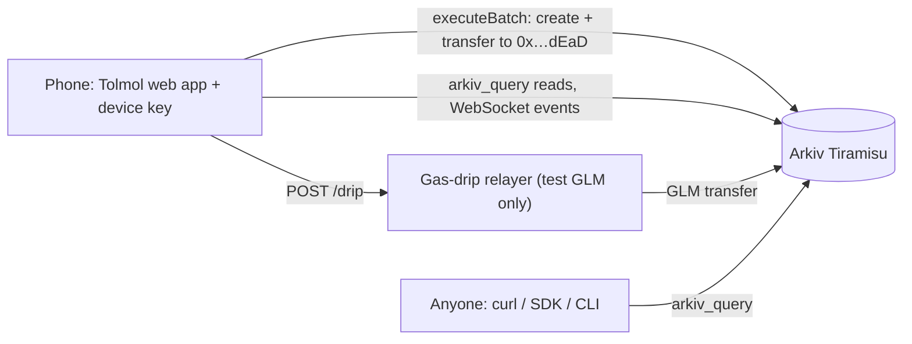

# Tolmol · तोलमोल

**A community-witnessed, tamper-evident ledger of ration (PDS) shortfalls, so beneficiaries have shared,
queryable evidence that no dealer, official or app host can quietly erase.**

Built on [Arkiv](https://arkiv.network), the Web3 database, for the Arkiv Global Tour Stop (9 to 18 Oct 2026).
Tracks: **Best Indian Use Case** (primary), Censorship Resistance, Open Source, Privacy, Security.

| | |
|---|---|
| Live app | **https://tolmol-web-kappa.vercel.app** (Vercel; no login, works on a phone, English + हिन्दी) |
| Backup host | https://amannx21.github.io/Tolmol/ (GitHub Pages; the same build, deployed from `main`) |
| npm package | [`tolmol-sdk`](https://www.npmjs.com/package/tolmol-sdk): `npm install tolmol-sdk` (read the data and apply the rules; read-only CLI `npx tolmol-sdk`) |
| One-file reader | [`mirror.html`](https://tolmol-web-kappa.vercel.app/mirror.html): no framework, no build, any Arkiv RPC; save it and open it anywhere |
| Gas-drip relayer | https://tolmol-relayer.vercel.app/health (Vercel; sends test GLM to fresh device wallets only) |
| Demo video (3 min) | **[FILL]** |
| Network | Arkiv **Tiramisu** testnet, chain ID `7738577` · [explorer](https://tiramisu.explorer.arkiv.network) |
| Data contract | [`arkiv/schema.md`](arkiv/schema.md) · Friction report: [`arkiv/friction.md`](arkiv/friction.md) · Wallets: [`arkiv/wallets.md`](arkiv/wallets.md) |
| Judged commit | **[FILL at deadline: SHA of tag `submission-v1`]** |

> **All data is synthetic.** Every shop ID starts with `SYN-` and every seeded report carries `synthetic = true`.
> Districts are real place names; the shops, dealers and reports are invented. No real person appears in the demo records. Landing-page reference photographs show real PDS settings and carry separate photo credits.

| Live dashboard | Hindi | Shop timeline | A report (owner `0x…dEaD`) |
|---|---|---|---|
|  |  |  |  |

## Try it in two minutes (judges)

No login, no wallet, works on a phone. Every step reads Arkiv straight from your browser.

| Open | You should see |
|---|---|
| [`#/tour`](https://tolmol-web-kappa.vercel.app/#/tour) | The whole story in six steps: report, neighbours confirm, the dealer answers, the reporter says "fixed" or "not fixed", an official acts, the record stays |
| [`#/shop/SYN-BR-0042`](https://tolmol-web-kappa.vercel.app/#/shop/SYN-BR-0042) | Shortfall per month, the dealer's answers, how many reporters said "fixed", and **"2 answers or follow-ups ignored"**: a planted fake dealer answer and a fake "fixed" written by a stranger's wallet. Same attributes as the real ones; only `$creator` differs, so they do not count |
| [`#/report`](https://tolmol-web-kappa.vercel.app/#/report) → the last screen | **"Before you send: what becomes public"**: the public fields in plain words, what stays on the phone, and that the entitlement can hint at family size. Tick "scolded or threatened" and a separate anonymous ID switches on by itself |
| [`#/dashboard?state=BR`](https://tolmol-web-kappa.vercel.app/#/dashboard?state=BR) | Districts ranked by shortfall, the "needs official attention" list, filters for each of the 17 problems |
| Footer → **Arkiv queries on this page** | Every query the page sent, exactly as sent, its cost (`Arkiv-Cost`) and the reads you have left (`RateLimit`). **Copy as curl** and run it: the same answer without this site |
| [`mirror.html`](https://tolmol-web-kappa.vercel.app/mirror.html) or `npx tolmol-sdk` | The same data with no Tolmol code in the way |

## The problem

India's Public Distribution System gives free grain to **81.35 crore people** through **over 5 lakh fair-price
shops** ([PIB, 29 Nov 2023](https://www.pib.gov.in/PressReleasePage.aspx?PRID=1980686)). Under the National Food
Security Act, a priority household is entitled to **5 kg per person per month** and an Antyodaya family to
**35 kg per family per month** ([nfsa.gov.in](https://nfsa.gov.in/portal/nfsa-act)).

People still get less:

- About **28%** of PDS grain never reaches the intended beneficiaries, by ICRIER's estimate from the
  2022-23 household consumption survey (25.3% without the state-offtake adjustment). The authors note the survey
  caveats ([Das, Roy & Gulati, ICRIER, Nov 2024](https://icrier.org/pdf/pb-27.pdf)).
- The government itself changed the rules in 2021 to fund electronic weighing scales linked to ePoS devices, "to
  ensure right quantity to beneficiaries" ([PIB, 21 Jun 2021](https://www.pib.gov.in/PressReleasePage.aspx?PRID=1729070)).
- When verification fails, people get nothing: in Jharkhand's biometric rollout, **1.5 to 2 million** legitimate
  beneficiaries lost access at some point ([Muralidharan, Niehaus & Sukhtankar, NBER w26744](https://www.nber.org/papers/w26744)).

When a card holder is given 4 kg instead of 5, there is no neutral record. It is their word against the
dealer's, and complaints made on a portal or a WhatsApp group can be deleted, ignored or lost. Full source notes:
[`docs/SOURCES.md`](docs/SOURCES.md).

## What Tolmol does

1. **Report.** A card holder picks their (synthetic) shop, month and grain, and enters what they were entitled
   to and what they received. Their phone signs it with an anonymous device key. No name, phone, Aadhaar or card
   number is asked for or stored, and there is no free-text box. In Full mode the reporter also chooses how long
   the report stays on Arkiv (30, 90 or 180 days) and whether neighbours may extend it.
2. **Corroborate.** Another card holder at the same shop taps "I also got less at this shop this month" on their
   own phone. Two confirmations automatically extend the report's life (unless the reporter chose a fixed one).
3. **Check and export.** Anyone (journalist, NGO, social-audit group, RTI filer) can see the worst shops in a
   district, open a shop's timeline, view it **as it was at any past block**, and download CSV/JSON evidence where
   every row has an entity key, creator address, block number and explorer link.
4. **Act on it.** "Draft my RTI" writes a Right to Information application (English or Hindi) to the District
   Supply Office for the shop's stock and distribution registers, citing Sections 6(1), 6(2), 7(1) and 7(5) of
   the RTI Act 2005, with the on-chain evidence as an annex. Name and address are blanks filled in by hand.
   **"Complaint to the DGRO"** writes a complaint to the District Grievance Redressal Officer under Section 15 of
   the National Food Security Act, with the shop's shortfall and issue counts. Each shop page also has a QR code to
   share, so card holders at the shop can open it and confirm reports.
5. **Say what else went wrong: four short questions, 17 answers.** Grain (thumb taken but grain not given, the
   machine slip shows more than you got, not weighed in front of you, a different grain, a family member's share left
   out, bad grain); money (asked to pay, made to buy dal/salt/oil/soap, no receipt); getting the ration (fingerprint or
   OTP failed, shop closed, 3+ trips, told it "lapsed", other-state card refused); and how you were treated (card kept
   by the dealer, scolded or threatened, no display board). Each is a problem card holders report in practice
   ([`docs/SOURCES.md`](docs/SOURCES.md) §13). Stored only as two small numbers, never as text.
6. **Know what to do next.** After a report: call the free food helpline **1967**, print the DGRO complaint or the
   RTI. If a card from another state was refused, it adds that under One Nation One Ration Card the ration can be
   taken at any ration shop in India.
7. **Fix a mistake without deleting anything.** A reporter can **withdraw** their own report. The withdrawal is a
   new sealed entity; the report stays readable, tagged "withdrawn by its reporter", and drops out of totals. Only
   the device that wrote a report can withdraw it.
8. **Check the evidence.** The **Verify** page takes an exported JSON evidence file and checks every row against Arkiv, so an
   official handed an evidence file can tell whether it was edited.
9. **Verified card holders (demo with test cards).** Anyone can make a device ID, so a phone can be verified with a
   ration card: a verifier checks the card's signature once and publishes "this phone is a verified card holder" on
   Arkiv. Reports and confirmations then show **✓ verified card holder**, shop pages say how many reports are verified,
   and the dashboard can count only verified reports. One card verifies one phone. The demo uses **synthetic test
   cards** ([`#/test-cards`](https://tolmol-web-kappa.vercel.app/#/test-cards)) signed by a test key; in future the card is
   the DigiLocker ration card ([`docs/VERIFIED_REPORTERS.md`](docs/VERIFIED_REPORTERS.md)). Verification is optional, so
   nobody is silenced.
10. **Shops answer, reporters confirm (a community score card).** The shop's dealer, verified with a (test) dealer
   licence, can answer any report about their shop by picking what they did: full quantity will be given, stock
   arrived, scale checked, shop open as displayed, board updated, receipt given, money returned, help when fingerprint
   fails, bad grain replaced, other-state card holders served, or "we dispute this". The choices follow the dealer's
   duties in the TPDS (Control) Order 2015, clause 10. **There is no text box**, so a dealer cannot name or threaten
   anyone, and answers are sealed like reports. Only the report's own phone can then say **"fixed ✓"** or **"not fixed
   ✗"**. Shop pages show a score card (answered, fixed as confirmed by reporters, not fixed, disputed), and the
   dashboard shows it per shop. A shop improves its standing only by fixing things its reporters confirm, never by
   editing or hiding reports.
11. **Officials act on the record.** The dashboard has a public **"Needs official attention"** list, worked out from the
   evidence with fixed rules anyone can check (20%+ short over 3+ reports, money charged for free grain, reporters
   saying "not fixed", reports the shop ignored, confirmations, verified card holders). A verified official of the
   district (test official ID in the demo) can record what the department did, on the shop's page: inspection
   ordered, inspected (shortage found / no issue), show-cause notice, licence suspended or cancelled, case registered
   under the Essential Commodities Act, grain restored. These follow the TPDS (Control) Order 2015, clauses 10(7),
   11(1) and 13. Actions are sealed, so nobody, the department included, can quietly remove them. A shop leaves the
   list only when its numbers improve, so recording an action cannot whitewash a shop, and inaction stays visible.

12. **The dealer's stock board, read against what people got.** The verified dealer posts the month's grain received
   and distribution days (the board every fair-price shop must display, TPDS Control Order 2015 cl. 10(4)(ii)) as a
   sealed `tolmol.stock` entity. The shop page sets it against the reports: *"the board says 2,000 kg; 14 card holders
   got 22% less; about 440 kg unaccounted for (an estimate)"*. A board cannot be edited, only re-posted, and every
   version stays visible. No board after the 5th is shown loudly, so silence is evidence too.
13. **Fair shop badge, earned and lapsing.** A shop earns it from public evidence only: 3+ reports from 2+ phones
   under 5% short, every shortfall report answered, no reporter saying "not fixed", a stock board this month. It is
   checked live each time the page opens, and the dealer can print a QR that opens the live check, so a printed
   badge cannot outlast the evidence. Dealers get a reason to want Tolmol, not only to fear it.
14. **Check my shop.** One box on the home page: type or pick any shop, school or panchayat and get red / amber /
   green / grey in plain words, from three queries and the same rule for everyone (`shopVerdict`).
15. **One ledger, three schemes.** The same evidence model now also records **school meals** (PM POSHAN: school days
   with a hot meal, at a school) and **MGNREGA wages** (rupees owed vs paid, at a gram panchayat), each with its own
   questions, answers from the head teacher or employment assistant, official actions, and letters to the right
   authority (District Education Officer; MGNREGA Programme Officer and Ombudsperson). Ration data did not change, and
   older readers simply do not see the new records ([`arkiv/schema.md`](arkiv/schema.md#other-schemes-on-the-same-ledger)).
   Ration stays the first workspace; a bar under the menu keeps School meals and MGNREGA wages in view on every page,
   each a separate workspace with its own home, report and records. Their reports are as easy as ration's: one
   question per screen read aloud in Hindi, big + / − steps instead of typing, and the same privacy protections.
   MGNREGA wages are rounded to ₹500 by default, because muster rolls are public and an exact amount could name the
   worker.
16. **Privacy you can feel.** Before sending, a box shows what becomes public and what stays on the phone. Reports
   can be held on the phone and sent at a **random time 1 to 6 hours later**, so the moment a report lands cannot be
   matched to who was at the counter; this switches on by itself for risky reports and for shops where few people have
   reported this month (which also gets a warning). **"Prove this report is mine"** lets a reporter back their
   complaint at a hearing: the official reads out a one-time code, the phone signs it with the key that wrote the
   report, the official checks it against `$creator` (`#/proof`). Nothing new goes public.
17. **Choose whom to trust.** `#/trust` shows the one registry address every trust decision starts from, checks it
   against the address published in this repository (outside Arkiv and outside the site), lists the verifiers it
   names and when each approval lapses, and lets anyone switch to a registry they trust more (`?registry=0x…`), with a
   warning banner on every page while a custom registry is in use.
18. **Read it without Tolmol, and see what it costs.** `#/raw` lists every query the app makes for an outlet,
   generated from the app's own code, ready to copy as curl, JavaScript or Python. The footer inspector shows each
   query this page sent, its `Arkiv-Cost` and the reads left; when the free read budget runs out, pages show the
   last good copy, labelled, instead of going blank. A dependency-free Python reader
   ([`examples/tolmol_reader.py`](examples/tolmol_reader.py)) is written only from the data contract.

19. **Officials send inspectors, with authority that only narrows.** A verified district official can delegate a field
   inspector to one outlet for 1 to 30 days (`tolmol.delegation`). The inspector's phone can then record only
   inspection findings, only for that outlet, only inside the window; anything else it writes is ignored, and every
   finding shows "inspector, delegated by 0x…". The official can revoke it by deleting the delegation.

**One site for everyone.** Card holders, shop dealers, officials and visitors use the same link and the same menu
(Home, Shops, My activity, Verify, Get verified, About, Report). The home page shows what each person can do: a
verified dealer sees "N reports waiting for your answer", a verified official sees the attention list, a card holder
sees the status of their reports. Roles come from verification records on Arkiv, so they cannot be faked. **My
activity** lists this phone's reports with confirmations, the shop's answer and whether it was fixed. **See how it
works** (`#/tour`) walks through the whole story in six steps.

**Two modes, chosen on first visit and switchable anytime.** Easy mode changes how things look, never what you can
do: every page and option is in both.

- **Easy (आसान)** is for card holders who are not used to apps. It asks one question per screen with big buttons:
  shop (remembered after the first time), month, card type, family size, then the amount received set with
  large “1 kilo less” / “1 kilo more” buttons, with optional direct number entry. It reads each question aloud in Hindi with the phone's own voice.
  Test gas is fetched silently, and there are no blockchain words. After saving, a WhatsApp button asks
  neighbours to confirm, and confirming is one big "मुझे भी कम मिला ✓" button.
- **Full (पूरा)** is for helpers, journalists and auditors: dashboard, per-grain form, explorer links, history
  and exports. In Easy mode the same details sit behind "जाँच के लिए पूरा विवरण" (details for auditors).

Both modes write exactly the same Arkiv entities through the same validated SDK calls.

Works on a low-end phone: installable (web manifest), the app shell loads offline, and a report made with no
signal is kept on the phone and signed and sent automatically when the connection returns. The shop QR code is
meant for WhatsApp, NGO posters or panchayat boards, not the dealer's wall, where it would just be torn down.

## Why Arkiv (and what breaks without it)

| If we used… | What breaks for a card holder, a parent or a worker |
|---|---|
| **Postgres behind our API** | We, our host or anyone who pressures us can `DELETE` a complaint or edit a number, and nobody outside can tell. The record is only as trustworthy as the operator. |
| **Our own API with signed records** | Signatures prove authorship, but the operator still decides what to serve. Hiding a shop's complaints is invisible to readers. |
| **IPFS** | Content is immutable, but there is no way to ask "all reports for shop X in October with shortfall over 10%" without building and trusting an indexer. Pinning is a cost someone stops paying. |
| **A subgraph over a contract** | Works, but needs a contract, an indexer and its operator. The query layer is one more thing that can lag or be turned off. |

What Tolmol relies on, and gets only from Arkiv:

- **Queryable and owned by no one.** Reports are typed, indexed attributes that any browser can query with
  `arkiv_query`, with no Tolmol backend in between. If our website disappears, the data does not.
- **Unforgeable authorship.** `$creator` is set by the protocol from the signer. Every trust rule depends on it:
  per-device dedupe, a witness from a different device, answers and monthly boards only from the outlet's verified
  operator, "fixed" and withdrawals only from the reporter, official actions only from that district, an inspector's
  findings only inside the delegated window, and the hearing proof (the signer must be the report's `$creator`).
- **Undeletable without a contract.** `readonly` + an ownership transfer to `0x…dEaD` in the same atomic batch
  means nobody (not even the reporter) can edit or delete a report.
- **Community-kept lifetime.** `permissionlessExtension` lets the people who corroborate a report keep it alive.
- **History.** `atBlock` reads show exactly what was public at any block, for evidence that something was (or was
  not) on record at a given time.
- **Authority that expires by itself.** An inspector's delegation is an entity whose window ends at a block; the
  official keeps ownership so they can revoke it early. No contract, no admin list.

**Kept off Arkiv on purpose:** names, phone numbers, Aadhaar, ration card and job card numbers, children's names,
addresses (hashing does not help, they are guessable), free text, photos of receipts or scales, household size as a
field (but see below), the exact time of a report (rounded to the day), exact MGNREGA wages (rounded to ₹500, because
muster rolls are public), proofs of authorship (checked in person, never stored), device private keys, relayer
rate-limit data and IPs, and aggregates such as the Fair shop badge (anyone can recompute them). Details in [`arkiv/schema.md`](arkiv/schema.md#what-stays-off-arkiv-on-purpose).

**Honest limit, shown before sending.** The amount you were due (`entitled_g`) is public, and so is the rule that
sets it (5 kg a person, 35 kg for an Antyodaya card), so it can hint at your family size. We keep the exact amount
because rounding it would distort the shortfall, which is the evidence. Every report screen shows a "what becomes
public" box before you send, and reports about threats or a kept card go out under a separate ID by default.
There is no encryption because nothing private is ever sent: not sending it beats encrypting it.

## How we use Arkiv

Every feature below changes something the user sees. Permalinks to exact lines: [`docs/ARKIV_USAGE.md`](docs/ARKIV_USAGE.md).

| Arkiv feature | How Tolmol uses it | Why | Code |
|---|---|---|---|
| Typed attributes vs payload | 16 typed attributes per report (i32 grams, i32 basis points, i32 issue bitmask, u64 day, str IDs); **empty payload** | Everything a reader filters on is indexed; there is nothing else to store, and no field for free text | [`attributes.ts`](packages/tolmol-sdk/src/attributes.ts) |
| Compound queries + ranges | `state = BR AND month_num >= 202608 AND month_num <= 202610 [AND shortfall_bp >= x]` | Dashboard ranking by district and month range | [`queries.ts`](packages/tolmol-sdk/src/queries.ts) |
| `createdBy()` | Shops are trusted only from the registry wallet; dedupe checks use the device as creator | Fake shops never appear in the picker; one report per device per shop-month-grain | [`queries.ts`](packages/tolmol-sdk/src/queries.ts) |
| `OR` query + `createdBy()` | One query reads every outlet of every scheme: `(type = tolmol.shop OR type = tolmol.outlet)`, trusted only from the registry | Ration shops, schools and gram panchayats in one read; a separate type keeps ration-only readers unchanged | [`queries.ts`](packages/tolmol-sdk/src/queries.ts) |
| Typed attributes per scheme | A school or panchayat report carries `scheme`; its item fixes the unit (grams, meal days, rupees) | One data model for three schemes; readers drop a report whose scheme and item disagree | [`schemes.ts`](packages/tolmol-sdk/src/schemes.ts), [`attributes.ts`](packages/tolmol-sdk/src/attributes.ts) |
| `$creator` in the UX | Every report and witness shows its device address with an explorer link | Authorship anyone can verify, that no one can forge | [`ReportView.tsx`](apps/web/src/ReportView.tsx) |
| `$creator` as the trust rule | A withdrawal (`tolmol.correction`) counts only if its creator wrote the report | A dealer cannot "withdraw" a card holder's complaint | [`rules.ts`](packages/tolmol-sdk/src/rules.ts) |
| `$creator` + district for official actions | A `tolmol.action` counts only from a device verified as an official whose ID's shop is in the same district (from the registry); sealed in one batch | Strict action is on the record and attributable; nobody can fake it or delete it | [`official.ts`](packages/tolmol-sdk/src/official.ts) |
| `$creator` on both sides of an answer | A shop's answer (`tolmol.response`) counts only from a device verified as THAT shop's dealer; "fixed / not fixed" (`tolmol.followup`) only from the report's own device. Both sealed (readonly + transfer to `0x…dEaD`) | Neither the dealer nor the reporter can fake the other side or take back what they said | [`answers.ts`](packages/tolmol-sdk/src/answers.ts) |
| `createdBy()` chain of trust | Registry names verifiers (`tolmol.verifier`); a device is verified only by an attestation from a named verifier; one device per card | The "✓ verified card holder" badge cannot be forged by writing the same fields | [`verify.ts`](packages/tolmol-sdk/src/verify.ts), [`verifier.ts`](apps/relayer/src/verifier.ts) |
| Cursor pagination + pinned block | Every walk is `.limit(200).atBlock(head)` with `next()` | Consistent pages; dashboards beyond 200 reports | [`queries.ts`](packages/tolmol-sdk/src/queries.ts) |
| `atBlock` historical reads | "Show as it was at block N" on every shop page and in exports | Evidence of what was public at a point in time | [`ShopPage.tsx`](apps/web/src/ShopPage.tsx) |
| Creation flags | Reports and witnesses: `readonly` + `permissionlessExtension` (the reporter can switch extension off); flags are read back with `select({ creationFlags })` | Nobody can edit; the community can keep evidence alive unless the reporter wants it to expire on time | [`writes.ts`](packages/tolmol-sdk/src/writes.ts), [`queries.ts`](packages/tolmol-sdk/src/queries.ts) |
| Ownership transfer | Each report is handed to `0x…dEaD` in its creating batch | Removes the owner's delete right: nobody can delete it | [`writes.ts`](packages/tolmol-sdk/src/writes.ts) |
| Entity Expiration per type | Shops 180 days; reports **30, 90 or 180 days, chosen by the reporter**; witnesses = report deadline; withdrawals = report creation + 365 days | Expiry the user controls; lifetimes follow how long evidence is useful (complaint, RTI) | [`constants.ts`](packages/tolmol-sdk/src/constants.ts), [`ReportForm.tsx`](apps/web/src/ReportForm.tsx) |
| Lifetime Extension | The 2nd confirmation extends the report and its witnesses to +180 days (cap 365) | A lease renewed by community activity | [`writes.ts`](packages/tolmol-sdk/src/writes.ts), [`rules.ts`](packages/tolmol-sdk/src/rules.ts) |
| Atomic batches | Report = create + transfer; witness = create + transfer + N extensions | Either all of it lands or none: no window where a report is deletable | [`writes.ts`](packages/tolmol-sdk/src/writes.ts) |
| `predictEntityKeys` | Predicts the new key so the same batch can transfer it | Needed to reference an entity created in the same batch | [`writes.ts`](packages/tolmol-sdk/src/writes.ts) |
| WebSocket entity events | `watchEntityEvents` on a `webSocket()` transport, no `fromBlock` | The dashboard updates when a report lands, without polling | [`live.ts`](packages/tolmol-sdk/src/live.ts), [`Dashboard.tsx`](apps/web/src/Dashboard.tsx) |
| Sealed monthly boards + `$creator` | The verified operator posts the month's board (`tolmol.stock`: grain and cards; `tolmol.board`: meals served or wages paid), sealed; a correction is a new version and every version is shown; boards from anyone else are ignored | The outlet's own claim, set against the reports: "about N kg / ₹N unaccounted for" | [`stock.ts`](packages/tolmol-sdk/src/stock.ts), [`boards.ts`](packages/tolmol-sdk/src/boards.ts) |
| Verdicts recomputed, never stored | The Fair shop badge and the red / amber / green verdict are worked out by every reader from reports, answers, follow-ups and boards | Nobody can write a badge; it lapses by itself when things get worse | [`stock.ts`](packages/tolmol-sdk/src/stock.ts) |
| Entity Expiration as an authority window | `tolmol.delegation`: an official names an inspector for one outlet until a block (at most 30 days); readonly, owner kept so the official can delete it to revoke | An inspector's findings count only for that outlet, inside the window | [`delegation.ts`](packages/tolmol-sdk/src/delegation.ts), [`official.ts`](packages/tolmol-sdk/src/official.ts) |
| `$creator` checked off chain | At a hearing the reporter signs a one-time code with the report's key; the official checks the signer is the report's `$creator`. Nothing is written | "This report is mine" without becoming public | [`proof.ts`](packages/tolmol-sdk/src/proof.ts), [`proofUI.tsx`](apps/web/src/proofUI.tsx) |
| RPC headers `Arkiv-Cost`, `RateLimit` | Each query's cost and the reads left are shown in the footer; on 429 the last good answer is shown, labelled | The read budget is visible before it runs out (friction F13, F14) | [`metered.ts`](packages/tolmol-sdk/src/metered.ts), [`inspector.tsx`](apps/web/src/inspector.tsx) |
| Raw JSON-RPC, no Tolmol code | `#/raw` lists every query the app makes for an outlet, as curl, JavaScript or Python | Anyone can read the data without us | [`rawPage.tsx`](apps/web/src/rawPage.tsx) |
| Registry anchored outside Arkiv | `#/trust` checks the registry address against this repository and lets a person trust another registry | The one key everything starts from can be checked and replaced | [`trust.tsx`](apps/web/src/trust.tsx) |

## Reproduce it (judges)

### 1. See the data without our website

```bash
curl -s https://rpc.tiramisu.db-chain.testnet.arkiv.network \
  -H 'content-type: application/json' \
  -d "{\"jsonrpc\":\"2.0\",\"id\":1,\"method\":\"arkiv_query\",\"params\":[\"project = str('tolmol') AND type = str('tolmol.report') AND shop_id = str('SYN-BR-0042')\",{\"limit\":\"0xc8\",\"select\":{\"key\":true,\"creator\":true,\"owner\":true,\"expiresAt\":true,\"attributes\":true}}]}"
```

Every returned entity has `owner = 0x…dEaD`, a device `creator`, and the attributes in `arkiv/schema.md`.

Or open [`mirror.html`](https://tolmol-web-kappa.vercel.app/mirror.html) (one file, plain `fetch`, works with any
Arkiv RPC; it applies the rules in `arkiv/schema.md`), or run `node examples/minimal-reader.mjs SYN-BR-0042`,
which uses only `@arkiv-network/sdk` and prints raw totals for you to build on.

Or with the read-only CLI from a clone (no keys, no website):

```bash
npm ci && npm run build -w tolmol-sdk
npm run tolmol -- query --shop SYN-BR-0042                    # reports, witnesses, explorer links
npm run tolmol -- query --shop SYN-BR-0042 --format csv      # evidence export
npm run tolmol -- query --shop SYN-BR-0042 --at-block 518000 # what was public at that block
npm run tolmol -- dashboard --state BR                        # worst shops in Bihar (synthetic)
npm run tolmol -- answers --shop SYN-BR-0042                  # dealer answers and "fixed" that count, and the planted fakes that do not
npm run tolmol -- outlets --state BR                          # ration shops, schools and gram panchayats (one OR query)
```

### 2. Run it from a clean clone

```bash
git clone https://github.com/amannx21/Tolmol && cd Tolmol
npm ci
npm test                         # 103 unit tests, no network
node --import tsx scripts/privacy-audit.ts   # every Tolmol entity on Tiramisu vs the data contract (read-only)
npm run dev -w tolmol-web        # http://localhost:5173 (reads Tiramisu directly)
```

To write: open the app, tap **Get free test gas** (or fund the shown device address at
[hub.arkiv.network/faucet](https://hub.arkiv.network/faucet)), then **Report a shortfall**. Open the report link in
a second browser profile (a different device key) and tap **I also got less at this shop this month**.

### 3. Live end-to-end test and the synthetic dataset

```bash
cp .env.example .env             # add three funded Tiramisu test keys (see the file)
npm run test:e2e                 # files a report, two witnesses corroborate, checks burn owner + extension + atBlock
npm run seed                     # (needs REGISTRY key) publishes the synthetic shops and demo reports; idempotent
```

The seed writes [`docs/seed-manifest.json`](docs/seed-manifest.json): every shop, report and witness key with its
creator and transaction, so the evidence can be re-checked even after entities expire.

## Wallets that create the entities

| Address | Role |
|---|---|
| `0x6DBf6A36E27d814c58A05312913DCEEfc0dAe221` | Registry: creates every `tolmol.shop` and `tolmol.outlet` (synthetic) and names the verifiers |
| `0xDAD092E626A158220Aa2838d25CCD69F51de76BE` | Reporter in tests; funds the seed devices |
| `0xAe8DCc161d9F27fACFE6D48A8B4DF148D64ab9E3` | Witness A in tests |
| `0xA7EF19b057E28BcB7048a202992423Da937Df140` | Witness B in tests |
| `0x357A30b18BF4020F243186d76dBdD44b830119e2` | Relayer: sends test-GLM drips only, never creates entities |
| `0x1C58335A9C5c5a3440f8018984cf9069b7C9408B` | Card verifier: creates `tolmol.attestation` entities (named by the registry's `tolmol.verifier`) |
| `0x20e2B6010a4a9128EAEDea408B29A4AC5a44a410` | Demo official for Gaya district (verified with a private test official ID); recorded 3 actions on SYN-BR-0042 |
| `0xFdbFff21C655c698a69205D2eb5Ec73a2F2d2dE6` | Demo dealer of SYN-BR-0042 (verified with a private test licence); answers reports |
| `0x40885B892dFbc317F9ffb7b5A410e9E8f00406e0` | Demo dealer of SYN-BR-0001, the shop that earns the Fair shop badge; posts its stock board |
| `0xC29C54165B368C42E1263b675286aBd3DCfDCf0A` | Demo head teacher of school SYN-BR-5001; answers parents' reports, posts meal boards |
| `0xff2343feCC600f8A68DF60376334C68B3eA3a114` | Demo employment assistant of gram panchayat SYN-BR-7001; answers workers' reports, posts work boards |
| `0xDa4c041B4A1ec3825D6Fb389bfda91DBEC1188E6` | Demo inspector delegated to SYN-BR-0002 for 14 days; recorded one finding |
| `0x75a542B54Ab0E187e41b3644e47Ac546B7D1011f` | TEST card issuer: signs the synthetic test ration cards; never writes to Arkiv |
| 10 seed device wallets | Synthetic beneficiaries; listed in [`arkiv/wallets.md`](arkiv/wallets.md) and `docs/seed-manifest.json` |
| 3 "stranger" wallets | Wrote a fake dealer answer and a fake "fixed" at SYN-BR-0042 and SYN-BR-5001; the pages list them as ignored. See [`arkiv/wallets.md`](arkiv/wallets.md) |

Real users' device wallets are created in their browsers. To list every wallet that created a report, run the query
above without the `shop_id` filter and read `creator`.

## Track fit

Each track's question, answered as: who is harmed today, and what changes from day one with Tolmol.

**Best Indian Use Case (Why India?).** *Who:* PDS card holders (81.35 crore people, more than 5 lakh fair-price
shops), parents of children on PM POSHAN school meals, and MGNREGA workers, plus the social-audit groups, local
journalists, RTI filers and district officials who act for them. *Today:* each is owed a fixed amount at a known
place, and the only record (ePoS slip, meal register, muster roll) is kept by the side they would complain about; a
complaint is their word against the dealer's, the school's or the panchayat's. *From day one:* they report in under a
minute on a low-end Android browser, one question per screen read aloud in Hindi, with big + / − buttons and no
typing; neighbours confirm; the dealer, head teacher or employment assistant answers on the record and posts a
monthly board that Tolmol sets against the reports; officials get a public "needs attention" list, record actions
and send an inspector; the person prints a complaint to the right office (NFSA s.15 DGRO, District Education
Officer, MGNREGA Programme Officer) or an RTI, and sees their state's food helpline. *Works today:* a 141 KB (gzipped)
installable app that opens offline and queues reports, on two hosts. Honest limits: it needs a little test gas (our
relayer covers it), and the demo uses synthetic outlets in real districts.

**Censorship Resistance.** *Who is censored today:* the person whose complaint vanishes when a portal, a WhatsApp
admin, the dealer's friends or the app's host remove it, and the auditor who never sees the pattern. *From day one:*
every report, confirmation, answer, board and official action is sealed (readonly, handed to `0x…dEaD` in the
creating batch): nobody, including us, can edit or delete it. Anyone reads it without us: the curl above, `#/raw`
(every query the app makes, as curl, JavaScript or Python), the one-file `mirror.html` (any Arkiv RPC, works offline),
a Python reader with no dependencies, the SDK or the CLI. The site is on two hosts, takes any Arkiv endpoint, shows
the last good copy if the read budget runs out, and anyone can choose which registry to trust (`#/trust`).

**Privacy.** *Who is exposed today:* a person who complains about the dealer, head teacher or panchayat they depend on
every month, and can be scolded, refused work or have their card kept. *From day one:* the explorer shows nothing
personal: no name, phone, Aadhaar, card or job card number, child's name, address, household size field or free
text, not even hashed; 16 small attributes; empty payloads; the time rounded to the day. The person chooses the expiry
(30, 90 or 180 days) and whether neighbours may extend it, and sees "what becomes public" before sending. **A separate
anonymous ID per report** (on by default for threats, a kept ration or job card, money or bribes asked, children seated apart, and fake names on the muster roll) is funded by the relayer
like every fresh wallet, so nobody can link one person's reports, not even through who paid the gas. A random send
delay of 1 to 6 hours breaks the link to a shop visit; a warning shows when an outlet has few reporters; MGNREGA wages
are rounded to ₹500 because muster rolls are public; a hearing proof shows "this report is mine" in person and writes
nothing. Letters keep name and card number as paper blanks. `scripts/privacy-audit.ts` checks every Tolmol entity on
Tiramisu against [`docs/data-contract.schema.json`](docs/data-contract.schema.json) (PASS), and a GitHub Action reruns
it daily. Open: the entitlement can hint at family size (shown before sending), block times are public, and with the
option off, reports under one ID are linkable (threat model T15, T36, T48).

**Security.** *Who is misled today:* officials, journalists and other card holders who act on records that can be
forged ("all fixed", "full ration given") or quietly withdrawn. *From day one:* every count filters on `$creator`,
never on a field anyone can write: outlets only from the registry; per-device dedupe; witnesses from a different
device; answers and boards only from the outlet's verified operator; "fixed" and withdrawals only from the reporter;
official actions only from that district; an inspector's findings only for the delegated outlet inside its window.
Planted fakes (a fake dealer answer and a fake "fixed", at a shop and at a school) are shown as ignored, with their
writers. Derived numbers are recomputed by every reader, a Verify page catches an edited evidence file row by row, and
the registry address is checked against this repository. Fake reports from many phones are hard to stop, so Tolmol
makes them visible: each outlet page lists **patterns to look at** (3 or more phones filing within one minute, rapid
confirmations, one-off devices) from public block numbers and `$creator`, and the dashboard can leave burst reports
out; on the live data it flags exactly the shops our seed script filled in bursts. A phone can be **verified with a
card** (synthetic test cards in the demo): the badge counts only from verifiers the registry names, one card per
phone. 103 tests, CodeQL, and a rate-limited relayer that never signs data. See the threat model below for what is
still open.

**Open Source.** *Who is locked out today:* civic groups, journalists and other states' projects, who need a
permission and an integration for each portal's data. *From day one:* MIT; a documented data contract
([`arkiv/schema.md`](arkiv/schema.md), and all 13 entity types as JSON Schema in
[`docs/data-contract.schema.json`](docs/data-contract.schema.json)); a reusable [`tolmol-sdk`](packages/tolmol-sdk)
**published on npm** (`npm install tolmol-sdk`) with a changelog; a read-only CLI; a
[minimal reader](examples/minimal-reader.mjs) and a [Python reader](examples/tolmol_reader.py) written only from the
contract; a daily public data check; contribution notes. Every outlet and dashboard page prints the exact queries it
ran ("How this is computed"). The pattern is proven reusable: school meals and MGNREGA wages were added on the same
model (synthetic registry, device-signed claims, corroboration as lease renewal, sealed boards) without changing a
single ration record or breaking the published reader.

## Threat model (summary)

Mitigated: operator deletion or edits, website takedown, a blocked RPC, linking one person's reports (optional
separate IDs), forged authorship, fake shops, forged
derived numbers, duplicate and self-witness inflation, withdrawals by anyone but the reporter, edited evidence
files, relayer abuse, leaked secrets. **Open:** sybil wallets (partly limited by
gas and relayer caps, and made visible by burst patterns), collusion, dishonest reporters, and linkability of one device's reports. Full table:
[`docs/THREAT_MODEL.md`](docs/THREAT_MODEL.md).

## Architecture



No Tolmol database, no Tolmol read API. Details: [`docs/ARCHITECTURE.md`](docs/ARCHITECTURE.md).

## Future scope: government adoption

Fake accounts are the main open problem: anyone can make a device ID. The plan is a **verified, anonymous card-holder
badge**: one real ration card = one verified member, checked once (from home with the DigiLocker ration card through a
department-run or NGO verifier, or in person at a social-audit camp), after which reports prove "a verified card
holder" without saying who, so even a state verifier cannot tell who complained. It also covers department replies
on the record and signed ePoS weighing receipts. All of it is Arkiv entities trusted by `$creator`, with no Tolmol
database: [`docs/VERIFIED_REPORTERS.md`](docs/VERIFIED_REPORTERS.md) (design, not built).

## Known limitations

- Testnet only. Gas comes from the faucet or our relayer.
- Anonymous Arkiv reads are capped at about 100 queries per IP per ~13 minutes (friction F13). The app reads
  per viewer, so this is per person, but heavy use from one network can hit it.
- Verification uses **synthetic test cards** in this demo, and the public test cards, dealer licences and official
  IDs let anyone verify a phone as a card holder, a demo shop's dealer or a district official (threat model T35). In
  production the card would come from the state (DigiLocker). In this simple version the verifier could link a
  verified phone to its card (threat model T26); the anonymous design removes that.
- Unverified devices are still allowed (on purpose), so there is no proof that every device belongs to a real card holder (see the threat model). Design for an optional,
  anonymous "verified card holder" badge, built on Arkiv entities with no identity data: [`docs/VERIFIED_REPORTERS.md`](docs/VERIFIED_REPORTERS.md) (not built).
- Hindi strings were drafted with an AI assistant and need native review.
- The trust filter ("count only confirmed reports") is a view, not proof: confirmations can also come from sybil devices.
- The relayer keeps per-IP limits in instance memory on Vercel; the on-chain fresh-wallet checks are the hard limit.
- Expired entities leave queries; their transactions and our exports remain.

## Built during the hackathon

All code was written between 13 and 18 Oct 2026. Pre-existing work: **none**. The only earlier commit
(`0902494`) is GitHub's generated `LICENSE` and `.gitignore`. Timeline: [`docs/BASELINE.md`](docs/BASELINE.md).

## Licence

[MIT](LICENSE)
