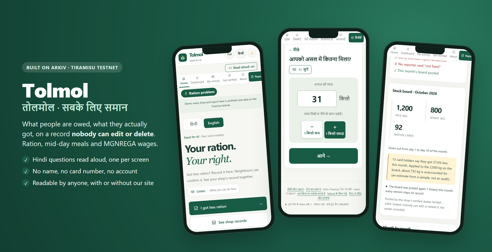
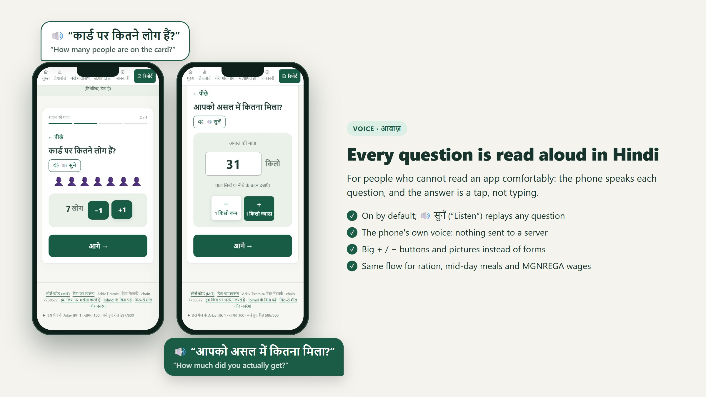
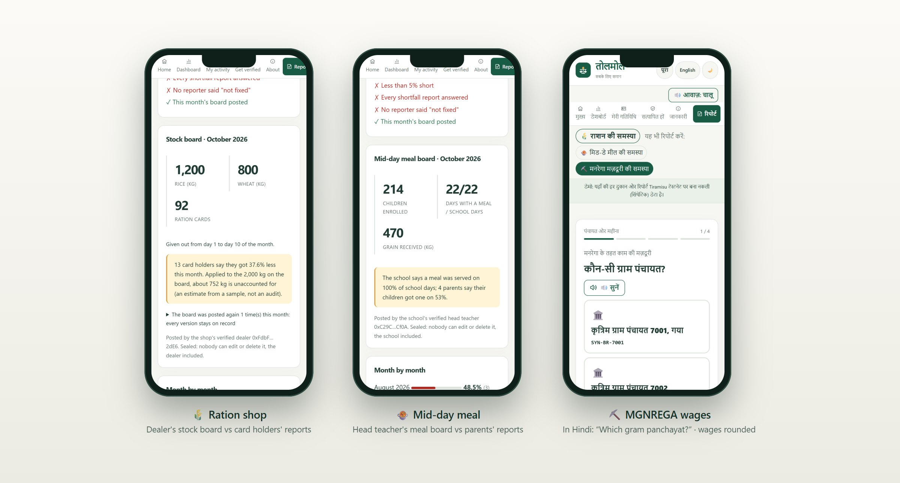
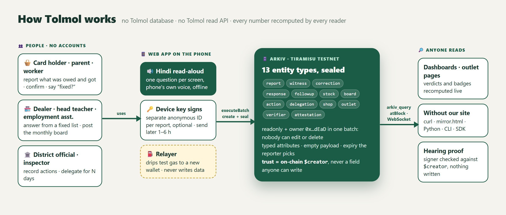

<div align="center">



# Tolmol · तोलमोल

**What people are owed, what they actually got, on a record nobody can edit or delete.**

**A complaint anyone can make: tap, listen, done.** The phone reads every question aloud in Hindi; answers are big
buttons. No typing, no forms, no sign-up, no app to install.

[Open the app](https://tolmol-web-kappa.vercel.app) · [Demo video](https://youtu.be/e98TA-ygH4M) · [Backup host](https://amannx21.github.io/Tolmol/) ·
[Data contract](arkiv/schema.md) · [npm: `tolmol-sdk`](https://www.npmjs.com/package/tolmol-sdk) ·
[One-file reader](https://tolmol-web-kappa.vercel.app/mirror.html)

[](https://github.com/amannx21/Tolmol/actions/workflows/ci.yml)
[](https://github.com/amannx21/Tolmol/actions/workflows/data-check.yml)
[](https://github.com/amannx21/Tolmol/actions/workflows/codeql.yml)
[](https://www.npmjs.com/package/tolmol-sdk)
[](LICENSE)

</div>

Ration card holders, parents of school children and MGNREGA workers record what they were owed and what they
actually got: grain at the ration shop, the mid-day meal at school, wages at the panchayat. Neighbours confirm it, the
dealer, head teacher or employment assistant answers on the record, and district officials act on it. Every record
lives on [Arkiv](https://arkiv.network), sealed so that nobody, including us, can edit or delete it, and anyone can
read it without our website.

It is built for the person at the ration counter, not for a computer user: someone in a village with a basic
smartphone, patchy signal and little time, who may not read easily. If she can tap and listen, she can complain.

Tolmol is a **testnet prototype** on Arkiv's Tiramisu network. Every shop, school and panchayat ID starts with `SYN-`
and every seeded record carries `synthetic = true`; districts are real place names, everything else is invented.

**In 60 seconds:** [report a shortfall in Hindi, read aloud](https://tolmol-web-kappa.vercel.app/#/report) →
[a shop's sealed record](https://tolmol-web-kappa.vercel.app/#/shop/SYN-BR-0042) →
[who checks the checkers](https://tolmol-web-kappa.vercel.app/#/track?state=BR) →
[what a stranger sees](https://tolmol-web-kappa.vercel.app/#/public).

## Why this exists

81.35 crore Indians get free grain at more than 5 lakh ration shops, yet about **28% of PDS grain never reaches
them** ([ICRIER, 2024](https://icrier.org/pdf/pb-27.pdf)). Mid-day meals and MGNREGA wages go missing the same way.
In each case the only record (the machine slip, the meal register, the muster roll) is kept by the side people would
complain about. A complaint becomes their word against the dealer's, and portals and WhatsApp groups lose or delete
it. Nobody sees the pattern across a shop or a district. Sources: [`docs/SOURCES.md`](docs/SOURCES.md).

## The product, person by person

### 🔊 A card holder, parent or worker reports, in Hindi, out loud: nothing to type, nothing to learn



1. Tap **मुझे कम राशन मिला** ("I got less ration"), or **मिड-डे मील की समस्या** ("mid-day meal problem") or
   **मनरेगा मज़दूरी की समस्या** ("MGNREGA wage problem"). The phone **reads each question aloud in Hindi**
   with its own built-in voice (on Android, the phone's text-to-speech, which works with no internet once the Hindi
   voice is downloaded: Settings → Text-to-speech). On laptops, Chrome and Edge use online voices: the sentence being
   read, which on the review screen includes the shop and amounts, goes to Google or Microsoft to be spoken. No name or
   card number is ever in it, and "Read aloud: off" stops it. 🔊 सुनें ("Listen") replays a question.
2. Answer with big buttons, pictures and **+ / −** steps: which shop, which month, how many people on the card, how
   much you got. No typing, no name, no card number, no account.
3. Tap what else went wrong: asked to pay, fingerprint failed, card kept, children seated apart, wages late. These are
   fixed choices, never free text.
4. Before sending, see **exactly what becomes public** and what stays on the phone. Choose how long it stays (30, 90
   or 180 days). A separate anonymous ID switches on by itself for reports a dealer could retaliate against. The
   report is sent at once; the person can choose to send it later, at a random time in the next 1 to 6 hours, and
   a held report shows on every page with **Send now**, so it is never forgotten on the phone. If someone may check the phone,
   **Remove Tolmol from this phone** (in About) deletes every key, waiting report and setting.
   **No signal?** The report is kept on the phone and goes out by itself when the connection is back.
5. Next steps appear: the state's food helpline, and a printable complaint to the right officer or an RTI letter,
   with name and address left blank to fill in by hand.

### 👥 Neighbours confirm

The report link goes out on WhatsApp. Others at the same outlet tap **मुझे भी कम मिला ✓** ("I got less too") on their
own phones. The second confirmation keeps the report alive longer, and the reporter can say no to that.

Neighbours can also say the opposite: **मुझे पूरा राशन मिला** ("I got my full ration this month"), once per phone. When 3
or more did and nobody confirmed a complaint, it is labelled **contradicted by others**: never hidden, because a dealer
can short a single family, but no longer a lone word against the dealer either.

### 🏪 The dealer, head teacher or employment assistant answers

Verified once with a (test) licence or staff ID, their phone shows a **My shop** item in the menu and a banner on every
page with the reports waiting for their answer; on their own outlet's reports the answer buttons come first.
They answer from a fixed list (stock arrived, scale checked, meals resumed, wages paid, or "we dispute this") and post
a **monthly board**: grain received, meals served, wages paid. Tolmol sets the board against the reports: *"13 card
holders say they got 37.6% less; about 752 kg is unaccounted for"*. Only the reporter's own phone can then say
**fixed ✓** or **not fixed ✗**. A shop that keeps its board posted and its reporters satisfied earns a **Fair shop**
badge, which lapses by itself if things get worse.

### 🏛️ The district official acts

The dashboard ranks outlets and keeps a public **"needs official attention"** list built from fixed rules. A verified
official records what the department did (inspection ordered, show-cause notice, licence suspended, dues restored) and
can send an **inspector** whose authority covers one outlet for up to 30 days. A shop leaves the list only when its
numbers improve, never because someone recorded an action.

**Who checks the checkers.** Every official's and inspector's finding is shown next to what people reported at that
outlet in the 60 days after it (`#/track`). A "no issue found" followed by 3+ reports from 2+ people at 20%+ short is
flagged **contradicted by later reports**, and one tap drafts a letter to the authority above the inspector (State
Food Commission for ration, the District Magistrate for mid-day meals, the MGNREGA Ombudsperson), with the signed
finding and the later reports attached.

**Proof without showing up.** If a reporter needs to show "this report is mine", their phone signs the official's
one-time code. They don't have to go: someone they trust (an NGO, a legal-aid volunteer) can carry the code and the
proof, and the official checks it against Arkiv. Nothing about the person is revealed or written.

### 🔎 Anyone checks

Journalists, social-audit groups and RTI filers see any outlet as it was at a past block, export evidence with an
explorer link per row, and check an edited evidence file against the chain. They can also skip our site entirely.

## One ledger, three schemes



| | Ration problem | Mid-day meal problem (PM POSHAN) | MGNREGA wage problem |
|---|---|---|---|
| People report | grain owed vs received | days with a hot meal | wages owed vs paid |
| Who answers, and their board | dealer: stock board | head teacher: meal board | employment assistant: work board |
| Complaint goes to | District Grievance Redressal Officer (NFSA s.15) | District Education Officer | Programme Officer, Ombudsperson |

## Trust and privacy you can see


- **Nothing personal on chain.** No name, phone, Aadhaar, card or job card number, or child's name, not even hashed.
  The time is rounded to the day and MGNREGA wages to ₹500, because muster rolls are public. Payloads are empty,
  except one: a **private note to the district official**, encrypted on the phone so only that official can read it
  (ECIES on secp256k1, AES-256-GCM). [`#/public`](https://tolmol-web-kappa.vercel.app/#/public) shows a real report and
  a real note exactly as a stranger sees them.
- **Fakes don't count.** Answers, boards, "fixed", withdrawals and official actions count only when they come from
  the right wallet, as recorded by Arkiv itself (`$creator`). Planted fakes are shown as ignored, with their writers.
- **Nobody can delete.** Each record is created read-only and handed to `0x…dEaD` in the same transaction. That
  includes us.
- **Checked every day.** `scripts/privacy-audit.ts` reads every Tolmol record on chain and checks it against the data
  contract; a GitHub Action reruns it daily. Threat model: [`docs/THREAT_MODEL.md`](docs/THREAT_MODEL.md).

## Architecture



There is **no Tolmol database and no Tolmol read API**. The web app reads and writes Arkiv directly, and every number
on screen is recomputed from Arkiv by whoever is reading.

| Layer | What it does | Code |
|---|---|---|
| Web app | Voice flow, outlet pages, dashboards, My shop, letters, proofs; English and Hindi; installable and offline | [`apps/web`](apps/web) |
| SDK | Data contract, validation of untrusted records, queries, sealed writes, trust rules, CLI | [`packages/tolmol-sdk`](packages/tolmol-sdk) |
| Relayer | Drips test gas to new phones and signs card verifications; never writes reports | [`apps/relayer`](apps/relayer) |
| Readers | A Python reader and a one-file HTML reader, written only from the data contract | [`examples`](examples), [`mirror.html`](apps/web/public/mirror.html) |

**Why Arkiv.** On Postgres behind our API, we or anyone pressuring us could delete a complaint unseen. IPFS cannot
answer "every report at this school in October" without an indexer someone runs. Arkiv gives queryable records with
no operator, authorship set by the network (`$creator`) that every trust rule relies on, records nobody can delete,
and lifetimes the reporter chooses. Each Arkiv feature and the line that uses it:
[`docs/ARKIV_USAGE.md`](docs/ARKIV_USAGE.md).

## Try it

Arkiv gives each anonymous visitor about 100 queries an hour; the footer of every page shows how many are left, and
pages fall back to a labelled saved copy if they run out.

| Open | What you'll see |
|---|---|
| [`#/tour`](https://tolmol-web-kappa.vercel.app/#/tour) | The whole story in six steps |
| [`#/report`](https://tolmol-web-kappa.vercel.app/#/report) | The voice flow, ending with what becomes public |
| [`#/shop/SYN-BR-0042`](https://tolmol-web-kappa.vercel.app/#/shop/SYN-BR-0042) | Stock board vs reports, score card, ignored fakes, officials' actions, history by block |
| [`#/shop/SYN-BR-5001`](https://tolmol-web-kappa.vercel.app/#/shop/SYN-BR-5001) · [`7001`](https://tolmol-web-kappa.vercel.app/#/shop/SYN-BR-7001) | A school's meal board; a panchayat's unaccounted wages |
| [`#/dashboard?state=BR`](https://tolmol-web-kappa.vercel.app/#/dashboard?state=BR) | Outlets ranked, the attention list, live updates |
| [`#/test-cards`](https://tolmol-web-kappa.vercel.app/#/test-cards) | Act as a card holder, dealer, head teacher or official |
| [`#/track?state=BR`](https://tolmol-web-kappa.vercel.app/#/track?state=BR) | Who checks the checkers: an inspector's "no issue found" contradicted by later reports |
| [`#/public`](https://tolmol-web-kappa.vercel.app/#/public) | A real report and a real private note exactly as a stranger sees them, and the daily audit |

## Read the data without Tolmol

```bash
curl -s https://rpc.tiramisu.db-chain.testnet.arkiv.network -H 'content-type: application/json' \
  -d "{\"jsonrpc\":\"2.0\",\"id\":1,\"method\":\"arkiv_query\",\"params\":[\"project = str('tolmol') AND type = str('tolmol.report') AND shop_id = str('SYN-BR-0042')\",{\"limit\":\"0xc8\",\"select\":{\"key\":true,\"creator\":true,\"owner\":true,\"attributes\":true}}]}"
```

Every report comes back with `owner = 0x…dEaD`. `python examples/tolmol_reader.py SYN-BR-0042` gives the same numbers
as the shop page using only Python's standard library, and `#/raw` in the app lists every query it makes as curl,
JavaScript or Python.

## Run it yourself

```bash
git clone https://github.com/amannx21/Tolmol && cd Tolmol && npm ci
npm test                                       # 121 unit tests, no network
npm run dev -w tolmol-web                      # http://localhost:5173, reads Tiramisu directly
npm run tolmol -- answers --shop SYN-BR-0042   # CLI: answers that count, fakes that don't
node --import tsx scripts/privacy-audit.ts     # every Tolmol record on chain vs the data contract
```

To write, tap **Get free test gas** in the app. For the end-to-end test and the seed, see [`.env.example`](.env.example).

### Report even if our site is blocked

The website and the relayer are conveniences, not gatekeepers. From any computer, with free test gas from the
public [faucet](https://hub.arkiv.network/faucet):

```bash
npm run tolmol -- key       # once: makes a key on this computer, prints only its address (paste it at the faucet)
npm run tolmol -- submit --shop SYN-BR-0042 --item rice --entitled 25000 --received 20000
npm run tolmol -- confirm 0x<report key>   # "I got less too", from a different key than the reporter's
```

The report is sealed the same way as from the app and shows on the same pages. Demo outlets only: never enter a real
card, name or phone number.

## Build on the data

- **Data contract:** [`arkiv/schema.md`](arkiv/schema.md), and all 16 record types as JSON Schema in
  [`docs/data-contract.schema.json`](docs/data-contract.schema.json).
- **SDK:** `npm install tolmol-sdk` reads the data and applies the same trust rules; `npx tolmol-sdk` is its CLI.
- **Build on it in 25 lines:** [`examples/build-on-tolmol.mjs`](examples/build-on-tolmol.mjs) prints every outlet's verdict
  and every inspector's track record for a state, straight from Arkiv, with no Tolmol server and no key. It needs
  nothing but `npm install tolmol-sdk` in an empty folder.
- **Wallets and their roles:** [`arkiv/wallets.md`](arkiv/wallets.md). **Everything else:** [`docs/FEATURES.md`](docs/FEATURES.md).

## Limits

- Testnet only. Gas comes from the faucet or our relayer.
- One person with many phones is hard to stop. Tolmol makes it visible (burst patterns, a verified-only view) rather
  than impossible.
- Test cards are public, so anyone can act as a demo dealer or official. In real use a state department would issue them.
- The amount a person was due can hint at family size; the app says so before sending.
- Read-aloud uses the browser's own voices. Chrome and Edge have Hindi and Indian-English voices; Brave and Firefox on
  Windows usually have no Hindi voice (the app then says so) and read English with an American voice. Use Chrome or
  Edge, or add Hindi under Windows Settings → Speech.

## Licence and credits

[MIT](LICENSE), for the code and docs. The photos and illustrations in the app are demo placeholders, credited in
[`docs/PHOTO-CREDITS.md`](docs/PHOTO-CREDITS.md): two are free-licence photos (CC BY 2.0 and CC0), the rest belong to
their owners and are not covered by MIT; a real deployment would use original or licensed images. Sources for every figure and rule: [`docs/SOURCES.md`](docs/SOURCES.md). Built 13 to 18 October 2026 for the Arkiv Global Tour Stop, with no
earlier code ([`docs/BASELINE.md`](docs/BASELINE.md)).
