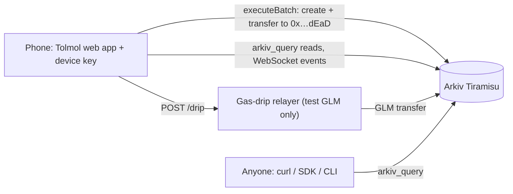

# Tolmol · तोलमोल

**A community-witnessed, tamper-evident ledger of ration (PDS) shortfalls, so beneficiaries have shared,
queryable evidence that no dealer, official or app host can quietly erase.**

Built on [Arkiv](https://arkiv.network), the Web3 database, for the Arkiv Global Tour Stop (9 to 18 Oct 2026).
Tracks: **Best Indian Use Case** (primary), Censorship Resistance, Security, Open Source.

| | |
|---|---|
| Live app | **https://amannx21.github.io/Tolmol/** (no login, works on a phone, English + हिन्दी) |
| Demo video (3 min) | **[FILL]** |
| Network | Arkiv **Tiramisu** testnet, chain ID `7738577` · [explorer](https://tiramisu.explorer.arkiv.network) |
| Data contract | [`arkiv/schema.md`](arkiv/schema.md) · Friction report: [`arkiv/friction.md`](arkiv/friction.md) · Wallets: [`arkiv/wallets.md`](arkiv/wallets.md) |
| Judged commit | **[FILL at deadline: SHA of tag `submission-v1`]** |

> **All data is synthetic.** Every shop ID starts with `SYN-` and every seeded report carries `synthetic = true`.
> Districts are real place names; the shops, dealers and reports are invented. No real person appears anywhere.

| Live dashboard | Hindi | Shop timeline | A report (owner `0x…dEaD`) |
|---|---|---|---|
|  |  |  |  |

## The problem

India's Public Distribution System gives free grain to **81.35 crore people** through **over 5 lakh fair-price
shops** ([PIB, 29 Nov 2023](https://www.pib.gov.in/PressReleasePage.aspx?PRID=1980686)). Under the National Food
Security Act, a priority household is entitled to **5 kg per person per month** and an Antyodaya family to
**35 kg per family per month** ([nfsa.gov.in](https://nfsa.gov.in/portal/nfsa-act)).

People still get less:

- About **28%** of PDS grain never reaches the intended beneficiaries, by ICRIER's estimate from the
  2022-23 household consumption survey (25.3% without the state-offtake adjustment). The authors note the survey
  caveats ([Das, Roy & Gulati, ICRIER, Nov 2024](https://icrier.org/pdf/pb-27.pdf)).
- The government itself changed the rules in 2021 to fund electronic weighing scales linked to ePoS devices, "to
  ensure right quantity to beneficiaries" ([PIB, 21 Jun 2021](https://www.pib.gov.in/PressReleasePage.aspx?PRID=1729070)).
- When verification fails, people get nothing: in Jharkhand's biometric rollout, **1.5 to 2 million** legitimate
  beneficiaries lost access at some point ([Muralidharan, Niehaus & Sukhtankar, NBER w26744](https://www.nber.org/papers/w26744)).

When a card holder is given 4 kg instead of 5, there is no neutral record. It is their word against the
dealer's, and complaints made on a portal or a WhatsApp group can be deleted, ignored or lost. Full source notes:
[`docs/SOURCES.md`](docs/SOURCES.md).

## What Tolmol does

1. **Report.** A card holder picks their (synthetic) shop, month and grain, and enters what they were entitled
   to and what they received. Their phone signs it with an anonymous device key. No name, phone, Aadhaar or card
   number is asked for or stored, and there is no free-text box.
2. **Corroborate.** Another card holder at the same shop taps "I also got less at this shop this month" on their
   own phone. Two confirmations automatically extend the report's life.
3. **Check and export.** Anyone (journalist, NGO, social-audit group, RTI filer) can see the worst shops in a
   district, open a shop's timeline, view it **as it was at any past block**, and download CSV/JSON evidence where
   every row has an entity key, creator address, block number and explorer link.

## Why Arkiv (and what breaks without it)

| If we used… | What breaks for a ration card holder |
|---|---|
| **Postgres behind our API** | We, our host or anyone who pressures us can `DELETE` a complaint or edit a number, and nobody outside can tell. The record is only as trustworthy as the operator. |
| **Our own API with signed records** | Signatures prove authorship, but the operator still decides what to serve. Hiding a shop's complaints is invisible to readers. |
| **IPFS** | Content is immutable, but there is no way to ask "all reports for shop X in October with shortfall over 10%" without building and trusting an indexer. Pinning is a cost someone stops paying. |
| **A subgraph over a contract** | Works, but needs a contract, an indexer and its operator. The query layer is one more thing that can lag or be turned off. |

What Tolmol relies on, and gets only from Arkiv:

- **Queryable and owned by no one.** Reports are typed, indexed attributes that any browser can query with
  `arkiv_query`, with no Tolmol backend in between. If our website disappears, the data does not.
- **Unforgeable authorship.** `$creator` is set by the protocol from the signer. The "different witness" rule and
  per-device dedupe both depend on it.
- **Undeletable without a contract.** `readonly` + an ownership transfer to `0x…dEaD` in the same atomic batch
  means nobody (not even the reporter) can edit or delete a report.
- **Community-kept lifetime.** `permissionlessExtension` lets the people who corroborate a report keep it alive.
- **History.** `atBlock` reads show exactly what was public at any block, for evidence that something was (or was
  not) on record at a given time.

**Kept off Arkiv on purpose:** names, phone numbers, Aadhaar, ration card numbers, addresses (hashing does not
help, they are guessable), free text, photos of receipts or scales, household size, device private keys, relayer
rate-limit data and IPs, and aggregates (anyone can recompute them). Details in [`arkiv/schema.md`](arkiv/schema.md#what-stays-off-arkiv-on-purpose).

## How we use Arkiv

Every feature below changes something the user sees. Permalinks to exact lines: [`docs/ARKIV_USAGE.md`](docs/ARKIV_USAGE.md).

| Arkiv feature | How Tolmol uses it | Why | Code |
|---|---|---|---|
| Typed attributes vs payload | 15 typed attributes per report (i32 grams, i32 basis points, u64 time, str IDs); **empty payload** | Everything a reader filters on is indexed; there is nothing else to store, and no field for free text | [`attributes.ts`](packages/tolmol-sdk/src/attributes.ts) |
| Compound queries + ranges | `state = BR AND month_num >= 202608 AND month_num <= 202610 [AND shortfall_bp >= x]` | Dashboard ranking by district and month range | [`queries.ts`](packages/tolmol-sdk/src/queries.ts) |
| `createdBy()` | Shops are trusted only from the registry wallet; dedupe checks use the device as creator | Fake shops never appear in the picker; one report per device per shop-month-grain | [`queries.ts`](packages/tolmol-sdk/src/queries.ts) |
| `$creator` in the UX | Every report and witness shows its device address with an explorer link | Authorship anyone can verify, that no one can forge | [`ReportView.tsx`](apps/web/src/ReportView.tsx) |
| Cursor pagination + pinned block | Every walk is `.limit(200).atBlock(head)` with `next()` | Consistent pages; dashboards beyond 200 reports | [`queries.ts`](packages/tolmol-sdk/src/queries.ts) |
| `atBlock` historical reads | "Show as it was at block N" on every shop page and in exports | Evidence of what was public at a point in time | [`ShopPage.tsx`](apps/web/src/ShopPage.tsx) |
| Creation flags | Reports and witnesses: `readonly` + `permissionlessExtension` | Nobody can edit; any community member can keep evidence alive | [`writes.ts`](packages/tolmol-sdk/src/writes.ts) |
| Ownership transfer | Each report is handed to `0x…dEaD` in its creating batch | Removes the owner's delete right: nobody can delete it | [`writes.ts`](packages/tolmol-sdk/src/writes.ts) |
| Entity Expiration per type | Shops 180 days, reports 90 days, witnesses = report deadline | Lifetimes follow how long evidence is useful (complaint, RTI) | [`constants.ts`](packages/tolmol-sdk/src/constants.ts) |
| Lifetime Extension | The 2nd confirmation extends the report and its witnesses to +180 days (cap 365) | A lease renewed by community activity | [`writes.ts`](packages/tolmol-sdk/src/writes.ts), [`rules.ts`](packages/tolmol-sdk/src/rules.ts) |
| Atomic batches | Report = create + transfer; witness = create + transfer + N extensions | Either all of it lands or none: no window where a report is deletable | [`writes.ts`](packages/tolmol-sdk/src/writes.ts) |
| `predictEntityKeys` | Predicts the new key so the same batch can transfer it | Needed to reference an entity created in the same batch | [`writes.ts`](packages/tolmol-sdk/src/writes.ts) |
| WebSocket entity events | `watchEntityEvents` on a `webSocket()` transport, no `fromBlock` | The dashboard updates when a report lands, without polling | [`live.ts`](packages/tolmol-sdk/src/live.ts), [`Dashboard.tsx`](apps/web/src/Dashboard.tsx) |

## Reproduce it (judges)

### 1. See the data without our website

```bash
curl -s https://rpc.tiramisu.db-chain.testnet.arkiv.network \
  -H 'content-type: application/json' \
  -d "{\"jsonrpc\":\"2.0\",\"id\":1,\"method\":\"arkiv_query\",\"params\":[\"project = str('tolmol') AND type = str('tolmol.report') AND shop_id = str('SYN-BR-0042')\",{\"limit\":\"0xc8\",\"select\":{\"key\":true,\"creator\":true,\"owner\":true,\"expiresAt\":true,\"attributes\":true}}]}"
```

Every returned entity has `owner = 0x…dEaD`, a device `creator`, and the attributes in `arkiv/schema.md`.

Or with the read-only CLI from a clone (no keys, no website):

```bash
npm ci && npm run build -w tolmol-sdk
npm run tolmol -- query --shop SYN-BR-0042                    # reports, witnesses, explorer links
npm run tolmol -- query --shop SYN-BR-0042 --format csv      # evidence export
npm run tolmol -- query --shop SYN-BR-0042 --at-block 518000 # what was public at that block
npm run tolmol -- dashboard --state BR                        # worst shops in Bihar (synthetic)
```

### 2. Run it from a clean clone

```bash
git clone https://github.com/amannx21/Tolmol && cd Tolmol
npm ci
npm test                         # 40+ unit tests, no network
npm run dev -w tolmol-web        # http://localhost:5173 (reads Tiramisu directly)
```

To write: open the app, tap **Get free test gas** (or fund the shown device address at
[hub.arkiv.network/faucet](https://hub.arkiv.network/faucet)), then **Report a shortfall**. Open the report link in
a second browser profile (a different device key) and tap **I also got less at this shop this month**.

### 3. Live end-to-end test and the synthetic dataset

```bash
cp .env.example .env             # add three funded Tiramisu test keys (see the file)
npm run test:e2e                 # files a report, two witnesses corroborate, checks burn owner + extension + atBlock
npm run seed                     # (needs REGISTRY key) publishes the synthetic shops and demo reports; idempotent
```

The seed writes [`docs/seed-manifest.json`](docs/seed-manifest.json): every shop, report and witness key with its
creator and transaction, so the evidence can be re-checked even after entities expire.

## Wallets that create the entities

| Address | Role |
|---|---|
| `0x6DBf6A36E27d814c58A05312913DCEEfc0dAe221` | Registry: creates every `tolmol.shop` (synthetic) |
| `0xDAD092E626A158220Aa2838d25CCD69F51de76BE` | Reporter in tests; funds the seed devices |
| `0xAe8DCc161d9F27fACFE6D48A8B4DF148D64ab9E3` | Witness A in tests |
| `0xA7EF19b057E28BcB7048a202992423Da937Df140` | Witness B in tests |
| `0x357A30b18BF4020F243186d76dBdD44b830119e2` | Relayer: sends test-GLM drips only, never creates entities |
| 10 seed device wallets | Synthetic beneficiaries; listed in [`arkiv/wallets.md`](arkiv/wallets.md) and `docs/seed-manifest.json` |

Real users' device wallets are created in their browsers. To list every wallet that created a report, run the query
above without the `shop_id` filter and read `creator`.

## Track fit

**Best Indian Use Case (Why India?).** Users: PDS beneficiaries (81.35 crore people), social-audit groups, local
journalists and RTI filers. The problem is specific to India's fair-price shops: under-weighing and failed
authentication leave card holders with nothing but their word. Tolmol works on a low-end Android browser, in Hindi
and English, with a numeric-only form and a 128 KB (gzipped) app. Honest limits: it needs a little test gas
(our relayer covers it), and the demo uses synthetic shops.

**Censorship Resistance.** Who is harmed if this data is censored? The card holder whose complaint vanishes,
and the auditor who never sees the pattern. We cannot delete or edit a report, and neither can our host: the
data is on Arkiv, readable with the curl above, the SDK or the CLI, even if the website is down.

**Security.** Authorship by `$creator` everywhere: registry-only shops, per-device dedupe, a witness must be a
different device, derived numbers recomputed by every reader, a rate-limited relayer that never signs data, no
secrets or personal data on chain. See the threat model below for what is still open.

**Open Source.** MIT. A documented data contract ([`arkiv/schema.md`](arkiv/schema.md)), a reusable
[`tolmol-sdk`](packages/tolmol-sdk) package, and contribution notes. Another scheme (mid-day meals, MGNREGA
wages) could reuse the same pattern: synthetic registry, device-signed claims, corroboration as lease renewal.

## Threat model (summary)

Mitigated: operator deletion or edits, website takedown, forged authorship, fake shops, forged derived numbers,
duplicate and self-witness inflation, relayer abuse, leaked secrets. **Open:** sybil wallets (partly limited by
gas and relayer caps), collusion, dishonest reporters, and linkability of one device's reports. Full table:
[`docs/THREAT_MODEL.md`](docs/THREAT_MODEL.md).

## Architecture



No Tolmol database, no Tolmol read API. Details: [`docs/ARCHITECTURE.md`](docs/ARCHITECTURE.md).

## Known limitations

- Testnet only. Gas comes from the faucet or our relayer.
- Anonymous Arkiv reads are capped at about 100 queries per IP per ~13 minutes (friction F13). The app reads
  per viewer, so this is per person, but heavy use from one network can hit it.
- No proof that a device belongs to a real card holder at that shop (see the threat model).
- Hindi strings were drafted with an AI assistant and need native review.
- Expired entities leave queries; their transactions and our exports remain.

## Built during the hackathon

All code was written between 13 and 18 Oct 2026. Pre-existing work: **none**. The only earlier commit
(`0902494`) is GitHub's generated `LICENSE` and `.gitignore`. Timeline: [`docs/BASELINE.md`](docs/BASELINE.md).

## Licence

[MIT](LICENSE)
