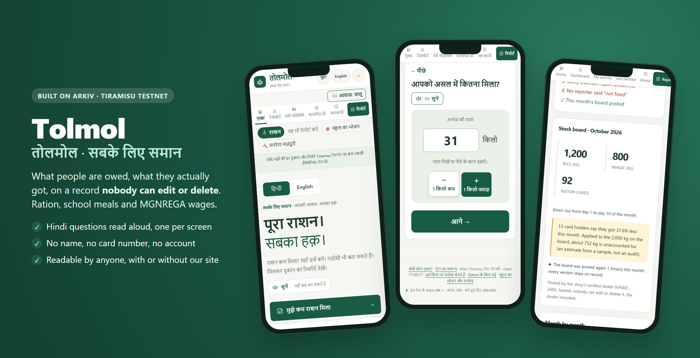
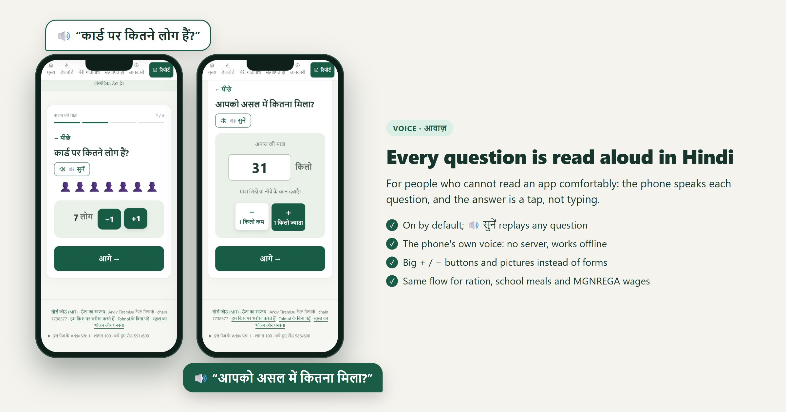
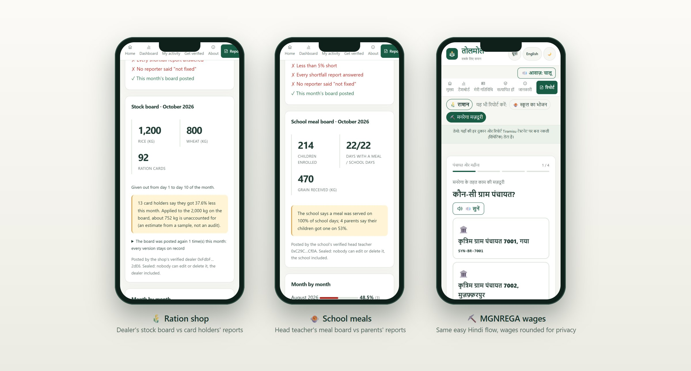
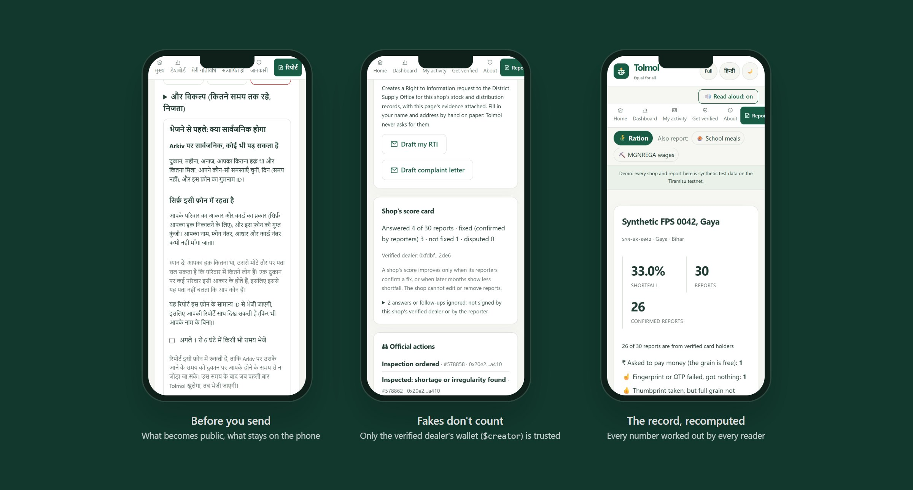

<div align="center">



# Tolmol · तोलमोल

**What people are owed, what they actually got, on a record nobody can edit or delete.**<br>
Ration shops, school meals and MGNREGA wages. Built on [Arkiv](https://arkiv.network) for the Arkiv Global Tour Stop.

**[Open the app](https://tolmol-web-kappa.vercel.app)** · [Backup host](https://amannx21.github.io/Tolmol/) ·
[`npm i tolmol-sdk`](https://www.npmjs.com/package/tolmol-sdk) · [One-file reader](https://tolmol-web-kappa.vercel.app/mirror.html) ·
Demo video **[FILL]**

`Best Indian Use Case` `Censorship Resistance` `Privacy` `Security` `Open Source`

</div>

> **All data is synthetic.** Every outlet ID starts with `SYN-` and every seeded record carries `synthetic = true`.
> Districts are real place names; shops, schools, panchayats, dealers and reports are invented.

## The problem

81.35 crore Indians get free grain at more than 5 lakh ration shops, yet about **28% of PDS grain never reaches
them** ([ICRIER, 2024](https://icrier.org/pdf/pb-27.pdf)). Children miss school meals and MGNREGA wages come short in
the same way. In each case the only record (the ePoS slip, the meal register, the muster roll) is kept by the side
people would complain about, so a complaint is their word against the dealer's, and portals and WhatsApp groups
lose or delete it. Sources: [`docs/SOURCES.md`](docs/SOURCES.md).

## 🔊 Made for people who don't use apps



Easy mode asks **one question per screen and reads it aloud in Hindi** with the phone's own voice (no server, works
offline). Answers are big buttons, pictures and **+ / −** steps, never typing. Read-aloud is on by default, **🔊 सुनें**
replays any question, and the same flow serves all three schemes. A report takes under a minute, with no name, no card
number and no account. Full mode (dashboards, exports, explorer links) is one tap away for helpers and journalists.

## How it works


1. **Report.** A card holder, parent or worker says what they were owed and what they got. The phone signs it.
2. **Confirm.** Neighbours at the same outlet confirm from their own phones; the second confirmation extends its life.
3. **Answer.** The verified dealer, head teacher or employment assistant answers from a fixed list (no text box) and
   posts a monthly board, which Tolmol sets against the reports: *"about 752 kg is unaccounted for"*.
4. **Fixed?** Only the reporter's own phone can say "fixed ✓" or "not fixed ✗".
5. **Act.** Officials see a public "needs attention" list, record what they did and send inspectors whose authority
   covers one outlet for a set number of days. People print an RTI or a complaint to the right office.

There is **no Tolmol database and no Tolmol read API**. Every number is recomputed by every reader from Arkiv.

## One ledger, three schemes



| | Ration (PDS) | School meals (PM POSHAN) | MGNREGA wages |
|---|---|---|---|
| Reports | grain owed vs received | days with a hot meal | wages owed vs paid |
| Answers and board | dealer: stock board | head teacher: meal board | employment assistant: work board |
| Letter goes to | District Grievance Redressal Officer (NFSA s.15) | District Education Officer | Programme Officer, Ombudsperson |

## Trust and privacy you can see



- **Nothing personal on chain.** No name, phone, Aadhaar, card or job card number, or child's name, not even hashed.
  The time is rounded to the day and MGNREGA wages to ₹500. The payload is empty.
- **You see what becomes public before sending.** You choose the expiry (30, 90 or 180 days). You can use a separate
  anonymous ID per report and a random send delay of 1 to 6 hours.
- **Fakes don't count.** Answers, boards, "fixed", withdrawals and official actions count only from the right
  on-chain `$creator`. Planted fakes are shown as ignored, with their writers.
- **Nobody can delete.** Each record is created read-only and handed to `0x…dEaD` in the same transaction. That
  includes us.
- **Prove it's yours, privately.** At a hearing the phone signs a one-time code and nothing is written (`#/proof`).

Threat model: [`docs/THREAT_MODEL.md`](docs/THREAT_MODEL.md). Public data check: `scripts/privacy-audit.ts` (PASS, rerun daily).

## Why Arkiv

| Instead of Arkiv… | What breaks |
|---|---|
| Postgres behind our API | We, our host or anyone who pressures us can delete a complaint, and nobody outside can tell |
| Our own signed API | Signatures prove authorship, but we still choose what to serve |
| IPFS | No way to ask "all reports at shop X in October" without an indexer someone runs |
| A subgraph | Needs a contract, an indexer and its operator: one more thing that can be switched off |

Tolmol relies on Arkiv for three things. **Queryable data owned by no one:** typed attributes, compound and `OR`
queries, `atBlock` history. **Protocol-set authorship (`$creator`):** every trust rule depends on it. **Records
nobody can delete:** readonly plus an ownership transfer in one atomic batch. Expiration and extension give lifetimes
the reporter chooses and inspector windows that end by themselves.

**How we use each feature, with links to the exact lines:** [`docs/ARKIV_USAGE.md`](docs/ARKIV_USAGE.md) (44 features).
The full feature list and track-by-track notes are in [`docs/FEATURES.md`](docs/FEATURES.md).

## Try it (judges)

| Open | You should see |
|---|---|
| [`#/tour`](https://tolmol-web-kappa.vercel.app/#/tour) | The whole story in six steps |
| [`#/report`](https://tolmol-web-kappa.vercel.app/#/report) | The voice flow; the last screen shows **what becomes public** |
| [`#/shop/SYN-BR-0042`](https://tolmol-web-kappa.vercel.app/#/shop/SYN-BR-0042) | Stock board vs reports, the score card, **"2 answers or follow-ups ignored"**, officials' actions, "Show as it was at block N" |
| [`#/shop/SYN-BR-5001`](https://tolmol-web-kappa.vercel.app/#/shop/SYN-BR-5001) · [`7001`](https://tolmol-web-kappa.vercel.app/#/shop/SYN-BR-7001) | A school's meal board, a panchayat's unaccounted wages |
| [`#/dashboard?state=BR`](https://tolmol-web-kappa.vercel.app/#/dashboard?state=BR) | Outlets ranked, the "needs official attention" list, live updates |
| [`#/test-cards`](https://tolmol-web-kappa.vercel.app/#/test-cards) | Act as a verified card holder, dealer, head teacher or official |
| [`#/raw`](https://tolmol-web-kappa.vercel.app/#/raw) · footer inspector | Every query as curl, JS or Python; its `Arkiv-Cost` and reads left |

**See the data without our website:**

```bash
curl -s https://rpc.tiramisu.db-chain.testnet.arkiv.network -H 'content-type: application/json' \
  -d "{\"jsonrpc\":\"2.0\",\"id\":1,\"method\":\"arkiv_query\",\"params\":[\"project = str('tolmol') AND type = str('tolmol.report') AND shop_id = str('SYN-BR-0042')\",{\"limit\":\"0xc8\",\"select\":{\"key\":true,\"creator\":true,\"owner\":true,\"attributes\":true}}]}"
```

Every report has `owner = 0x…dEaD`. `python examples/tolmol_reader.py SYN-BR-0042` gives the same numbers as the
shop page, using only Python's standard library.

**Run it from a clone:**

```bash
git clone https://github.com/amannx21/Tolmol && cd Tolmol && npm ci
npm test                                       # 103 unit tests, no network
npm run dev -w tolmol-web                      # http://localhost:5173, reads Tiramisu directly
npm run tolmol -- answers --shop SYN-BR-0042   # read-only CLI: answers that count and fakes that don't
node --import tsx scripts/privacy-audit.ts     # every Tolmol entity on chain vs the data contract
```

To write from a clone, tap **Get free test gas** in the app, or see [`.env.example`](.env.example) for the
end-to-end test (`npm run test:e2e`) and the seed.

## Repository

| | |
|---|---|
| [`apps/web`](apps/web) | Preact + Vite web app (installable, offline, English + हिन्दी) |
| [`apps/relayer`](apps/relayer) | Gas-drip relayer and card verifier (never writes reports) |
| [`packages/tolmol-sdk`](packages/tolmol-sdk) | Data model, Arkiv reads and writes, trust rules, CLI (on npm) |
| [`arkiv/schema.md`](arkiv/schema.md) · [`friction.md`](arkiv/friction.md) · [`wallets.md`](arkiv/wallets.md) | Data contract, friction report, wallets and their roles |
| [`docs/`](docs) | [Features](docs/FEATURES.md) · [Architecture](docs/ARCHITECTURE.md) · [Threat model](docs/THREAT_MODEL.md) · [Arkiv usage](docs/ARKIV_USAGE.md) · [Sources](docs/SOURCES.md) |

## Honest limits

- Testnet only, and the demo uses synthetic outlets. Gas comes from the faucet or our relayer.
- One person with many phones is hard to stop. Tolmol makes it visible (burst patterns, verified-only view) rather
  than impossible.
- Test cards are public, so anyone can act as a demo dealer or official. In production the state would issue them.
- The amount a person was due can hint at family size; the app says so before sending.
- Hindi strings need a native speaker's review.

## Built during the hackathon

All code was written between 13 and 18 Oct 2026. Pre-existing work: **none**. The only earlier commit (`0902494`) is
GitHub's generated `LICENSE` and `.gitignore` ([`docs/BASELINE.md`](docs/BASELINE.md)). Judged commit: **[FILL at
deadline: SHA of tag `submission-v1`]**. Licence: [MIT](LICENSE).
