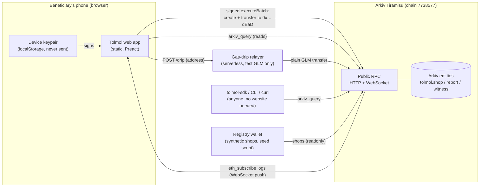

# Architecture

## Components

| Part | Where | Holds secrets? | Talks to |
|---|---|---|---|
| `apps/web` | Static files on GitHub Pages (or any static host) | The device key, in that browser only | Arkiv public RPC directly, the relayer |
| `packages/tolmol-sdk` | npm workspace package, used by the app, the seed script and the CLI | No | Arkiv RPC |
| `apps/relayer` | Serverless function (Cloudflare Workers / Node) | Relayer key (test GLM only) | Arkiv RPC |
| `scripts/seed.ts` | Developer machine | Seed keys in `.env` and `.seed-wallets.json` (git-ignored) | Arkiv RPC |
| Arkiv Tiramisu | Arkiv network | n/a | n/a |

There is **no Tolmol database and no Tolmol read API**. Every screen is built from `arkiv_query` calls made by
the viewer's own browser, so taking our servers down does not hide any data.

## Write paths

**File a report** (one transaction, signed by the device):

1. `validateReportInput` rejects extra fields, free text, non-synthetic shop IDs and impossible quantities.
2. Query Q4: has this device already reported this shop, month and grain?
3. `predictEntityKeys` gives the key and salt of the next entity this device will create.
4. `executeBatch` with one create (`readonly`, `permissionlessExtension`, 90 days, 15 typed attributes, empty
   payload) and one ownership change of the predicted key to `0x…dEaD`. Both land atomically.

**Corroborate** (one transaction, signed by a different device):

1. Read the report and its witnesses. Refuse if this device wrote the report or already confirmed it.
2. If this confirmation makes 2+ distinct witnesses: target = max(current, head + 180 days), capped at
   created + 365 days.
3. `executeBatch`: create the witness (readonly, permissionlessExtension, same deadline as the report),
   transfer it to `0x…dEaD`, and extend the report and its other live witnesses to the target.

## Read paths

- **Shop page:** Q2 + witnesses by shop and month, optionally `atBlock(N)` for "as it was at block N".
- **Dashboard:** Q6 (reports by state + `month_num` range) + witnesses by state and month. Ranking, dedupe and
  corroboration counts are computed on the device by the same rules as everyone else.
- **Live:** `watchEntityEvents` on a WebSocket client. Only entities whose ownership moves to `0x…dEaD` are
  fetched, because each `getEntity` costs 100 units of the viewer's anonymous query budget (friction F13).

## Why these choices

- **Static site + direct RPC reads** keep the censorship surface to the Arkiv network itself.
- **Device keys, not a server signer**, keep authorship per person: `$creator` differs per device, which the
  dedupe and different-witness rules depend on.
- **Burn transfer** turns "owner can delete" into "nobody can delete" without any smart contract.
- **Integer grams and basis points** make every reader compute identical numbers.
